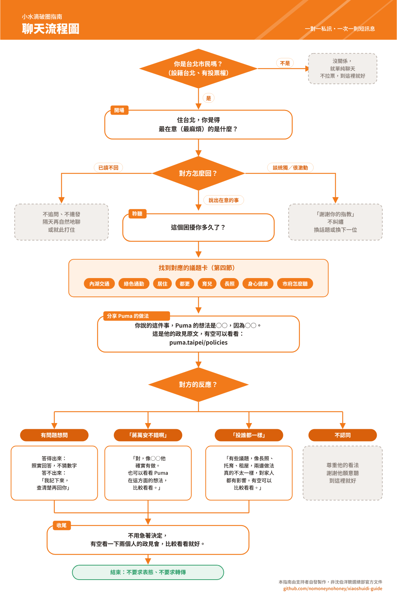

# 小水滴破圈指南

> 一人找一位台北市民、還不支持 Puma 的朋友，在 LINE 上一對一聊聊，請他給沈伯洋一次說明的機會。
>
> **一滴一位朋友｜不吵架，好好講政見**

- **使用期間**：11/19 – 11/27
- **投票日**：11/28（六），當天不能拉票
- **你的任務**：找一位還不支持 Puma 的台北朋友，認真聊一次。
- **對象**：設籍台北、有投票權的市民。不是台北選民就先跳過，時間有限。

> **本指南由支持者自發製作，非沈伯洋競選總部官方文件。**

版本 V1.0.0・2026-11-19

---

## 一、先認識 Puma：沈伯洋是誰

### 經歷

- 1982 年生，在台北五分埔長大。
- 台大法律系、法研所；美國賓州大學法學碩士；加州大學爾灣分校犯罪與法律社會學博士。
- 當過律師，早年在補習班教刑法用的名字是「撲馬」，Puma 這個暱稱就是從這裡來的。
- 國立臺北大學犯罪學研究所副教授。
- 2024 年起擔任立法委員，2026 年參選台北市長。

### 他想讓台北變成什麼樣子

他的看法是：台北人每個都很努力，但城市的腳步沒跟上，所以市府應該多陪伴、多分擔。台北已經從「沒有」走到「有」，接下來要從「有」走到「好」，重點是一點一點改善，不是大破大立。

口號是 **「台北順起來」**：讓長輩多一點照顧、孩子多一點陪伴、夾在中間的三明治世代有人接住。

### 五大政見主軸：HEART

| | 主軸 | 內容 |
|---|---|---|
| **H** | 空間 | 婚育宅、青年宅、更多綠蔭和公園、河岸與山徑 |
| **E** | 機會 | 幫市民培養能力、創造發展機會 |
| **A** | 陪伴 | 照顧長輩、陪伴孩子、支援家長 |
| **R** | 安心 | 城市韌性、身心健康、兒少安全 |
| **T** | 時間 | 目標每天替台北人省下 30 分鐘 |

### 上任 100 天先做的三件事

- **把樹種回來**：用專責單位、專法、專款，恢復城市綠蔭，打造都市微森林。
- **兒虐防治**：事證屬實就要求機構停業或相關人員停職，及時救援、安置孩子，市府當社工和幼保員的後盾。
- **改善營養午餐。**

他的做事方式是「你說我做」：先蒐集市民意見（「市長，你給我聽好了」平台、街頭肥皂箱），再提出解法。

## 二、四大心法

1. **共榮共好，絕不吵架。** 對方不是敵人，是同一座城市的鄰居。對方一激動，我們就打住，不糾纏，換下一位。不要連朋友都做不成。
2. **先聽對方在意什麼。** 先問對方住台北最在意的是什麼，聽完再講。再分享 Puma 在這件事上的政見，請對方自己看看。
3. **只談市政，不談黨和意識形態。** 遇到統獨或強烈意識形態的話題，跳過就好，不糾纏，換個話題或換下一位。
4. **講政見，不貼標籤。** 重點放在 Puma 打算怎麼做、為什麼這樣做，不批評、不標籤化現任。講清楚具體做法，讓對方自己判斷。

## 三、一段聊天的五個步驟

打字聊天和面對面不一樣：對方隨時可以已讀不回，長訊息也不會被讀完。所以一次只傳一則短訊息，等對方回了再接下一步。

1. **開場**：一對一私訊，先從生活聊起。
   > 想問你一下，住台北你覺得最麻煩的是什麼？
2. **聆聽**：等對方回完，不打斷、不糾正，也不要連發好幾則。可以問一句：
   > 這個困擾你多久了？
3. **分享 Puma 的做法**：從第四節找到對方在意的那一題，說 Puma 打算怎麼做、為什麼。
   > 你說的這件事，Puma 的想法是○○，因為○○。
4. **附上原始政見**：讓對方自己看原文。先寫一句自己的話，不要只丟連結。
   > 這是他的政見原文，有空可以看看：puma.taipei/policies
5. **收尾**：不要求對方表態，也不要求轉傳。
   > 不用急著決定，有空看一下兩個人的政見會，比較看看就好。

## 四、市政議題卡

每張卡片先寫一句可以問對方的話，再寫 Puma 的做法和理由，最後一行附上現任的做法供參考。完整政見以 <https://puma.taipei/policies> 為準。

### 內湖交通

- **可以問**：「你通勤都卡在哪一段？」
- **Puma 怎麼做**：
  - 捷運環狀線東環段，和內湖交通的配套一起設計
  - 民生汐止線先從汐止端蓋 4 站，民生社區那一端多和居民溝通，保留社區特色
- **為什麼**：塞車不能只靠一條捷運解決，路線和周邊配套要一起規劃。
- *現任做法：提出松山機場遷建，原址規劃台北 AI 園區。*

### 綠色通勤

- **可以問**：「你每天通勤要花多久？」
- **Puma 怎麼做**：
  - TPASS 納入共享電動機車
  - 串起自行車通勤路網；通勤時段 YouBike 電輔車前 30 分鐘免費
  - 通學區共同標準、公車安全改革
  - 捷運站、登山口設運動驛站，可寄物、換衣、沖洗
- **為什麼**：讓走路、公車、腳踏車、機車都成為真正方便的選項，補上最後一哩路，替大家省下時間。
- *現任做法：雙北公車 399 定期票。Puma 說過，399 如果是好政策，他上任也可以做。*

### 居住

- **可以問**：「你身邊的年輕人租得起房子嗎？」
- **Puma 怎麼做**：
  - 婚育宅、青年宅
  - 多元興辦社宅、包租代管
  - 老宅延壽：行動服務團到宅協助，降低公共區域修繕門檻
- **為什麼**：讓年輕人和新婚家庭住得起台北，也讓還不能重建的老房子住得安全。
- *現任做法：盤點社宅潛力基地，持續興建社宅。*

### 都市更新

- **可以問**：「你家附近有卡住的都更案嗎？卡在哪裡？」
- **Puma 怎麼做**：
  - 「無限都更」：政府先在公有地蓋好新宅
  - 住戶用舊屋換新屋，或換新屋的地上權；依估價多退少補，需要補差額的有貸款協助
  - 住戶只要搬一次家，騰出的舊基地再接著更新下一輪
- **為什麼**：很多都更卡在住戶要搬兩次、資訊不對稱。他主張資訊公開透明，讓住戶看得懂、算得清楚。
- *現任做法：降低公辦都更門檻、提高大街廓都更容積獎勵。*

### 育兒

- **可以問**：「你或身邊朋友帶小孩，最缺的是什麼？」
- **Puma 怎麼做**：
  - 增加免費臨托時數和臨托據點（細節請看政見連結）
  - 親子同行卡
  - 0–6 歲腸病毒疫苗免費
  - 「家庭一站通」：托育補助、兒童發展、孕前孕後、心理支持，一個窗口處理
  - 兒少安全治理機制，預防兒虐
- **為什麼**：他認為臨托不只是緊急時才需要，而是讓家長每週固定有時間喘口氣、照顧自己。
- *現任做法：提高生育獎勵、第二胎公托與準公托免費、校校有公托、新生兒臨托券等。*

### 長者與長照

- **可以問**：「家裡長輩的照顧，現在是誰在扛？」
- **Puma 怎麼做**：
  - 用社宅、都更和閒置空間，增加長照與住宿型機構
  - 外籍照顧人力接受 2 年專業培訓，補足人手
  - 彈性臨時托老券，減輕失智、失能長者家庭的負擔
  - 敬老卡升級，用在社交和運動；健身小巴進社區
  - 在宅醫療、到宅修繕、擴大爬梯機服務
- **為什麼**：讓長輩在熟悉的社區安心生活、多和人來往，也讓照顧長輩的家人有喘息空間。
- *現任做法：提高敬老卡點數並可累計，擴大使用範圍。*

### 身心健康

- **可以問**：「你最近有好好照顧自己嗎？」
- **Puma 怎麼做**：
  - 15–65 歲每年 6 次心理諮商
  - 50 歲以上帶狀疱疹疫苗，市府補助一劑（低收、中低收維持兩劑全額補助）
  - 使用呼吸器、製氧機的家庭，補助家用備援電力
- **為什麼**：從生理、心理到安全，替市民建一張照護網，讓人在城市裡不孤單。

### 市府怎麼聽市民

- **可以問**：「你覺得市府有在聽你講話嗎？」
- **Puma 怎麼做**：
  - 「市長，你給我聽好了」平台，持續蒐集市民意見
  - 街頭肥皂箱：市民站上去直接提問
  - 市政 debug 松，一起找問題、想解法
  - 改善公務員工作環境，讓市府有人力把事情做好
- **為什麼**：他的原則是「你說我做」：先聽市民遇到什麼問題，再提出解法。
- *現任做法：主打「說到做到」，以大巨蛋、輝達進駐北士科為代表政績。*

## 五、常見反應怎麼接

- **對方說「你們綠的都一樣。」**
  > 我懂，所以今天不談黨，只想聽你對台北哪件事最不滿意。
- **對方說「沈伯洋立場太極端。」**
  > 這個我尊重你的看法。不過市長要處理的是你家門口的事，可以給我一分鐘講這部分嗎？

  對方不想聽，就謝謝他，換下一位。
- **對方說「蔣萬安做得不錯啊。」**
  > 對，像○○他確實有做。如果你願意，我也想分享 Puma 在這方面的政見，你可以比較看看。
- **對方說「無限都更聽起來不可行。」**
  > 這題很多人在討論。它的設計是住戶自願選擇換屋或換權，有估價機制，價差多退少補。細節確實還要再看，你最擔心的是哪一點？

  自己說不清楚的話，就把官方管道給對方，或是先查清楚再回他。
- **對方說「投誰都一樣。」**
  > 我懂那種感覺。不過有些議題，像長照、托育、租屋，兩邊的做法真的不太一樣，對家裡的長輩、小孩、剛出社會的朋友都有影響。有空可以比較看看。
- **對方開始談統獨或意識形態**
  > 謝謝你的指教。

  到這裡就好，不糾纏，換個話題或換下一位。

### 私訊聊天的分寸

- 對方幾小時沒回，不要追問或連發。等他回，或隔天再自然地聊。
- 一則訊息講一件事。超過手機一個畫面的長文，不好閱讀。
- 朋友的問題和想法記在自己手機裡就好，不要整理成名單、截圖對話傳出去。那是朋友的個人資料，也是他對你的信任。

## 六、我們不是候選人：答不出來，就交給 Puma 本人

我們是支持者，不是候選人，也不是政策幕僚。被問倒很正常，硬答反而容易講錯。我們的任務不是替 Puma 回答每一個問題，而是**讓對方願意給他本人一次機會，親自聽他講**。

1. **誠實說不知道**
   > 這個問題問得很好，老實說我不太清楚細節，不想亂講誤導你。

   不知道就說不知道，不要硬拗。
2. **把問題記下來**
   > 我把你的問題記下來，查清楚再回你。

   把對方的問題記在自己手機裡，查到答案再回他。（只給自己看，不要傳給別人。）
3. **請對方直接聽本人講**
   > 與其聽我轉述，不如直接聽他本人怎麼說，你再自己判斷。

### 可以傳給對方的管道

- **政見總覽**：<https://puma.taipei/policies>
- **「市長，你給我聽好了」LINE 平台**：市民可以留言提問，也能看其他人的意見，適合對方說「我有話想講」的時候。對方覺得這是同溫層取暖的話，可以補一句：Puma 說留言提到蔣萬安的不到 1%，大多是垃圾桶、公車這類生活問題。
- **公辦政見會、電視辯論的完整影片**：兩位候選人在同一個場合各講 30 分鐘。請對方兩個人的都看，比較起來最公平。
- **實體市民對話活動**：Puma 辦過讓市民站上肥皂箱、直接提問、當場回答的活動。最後幾天如果還有場次，可以約對方一起去，自己問。

先把這些連結存在 LINE 的 Keep 或記事本裡，對方有興趣時馬上就能傳。只傳官方帳號或主流媒體的完整影片，不要傳剪輯過的片段。

### 請對方給一次機會

> 你不一定要支持他，只是希望你兩個人都聽過，再做決定。

> 我講得不好沒關係，但請不要因為我講不好，就不給他一個說明的機會。

> 你看完如果還是覺得蔣萬安比較好，我也尊重。

### 不要做的事

不要為了圓場而編答案、猜數字，或替 Puma 做他沒說過的承諾。講錯了，對對方也不公平。

## 七、紅線

- 不要標籤化蔣市長，也不傳嘲諷梗圖、影片。
- 不轉傳沒查證的數字，不剪輯、變造對方的影片或照片。深偽內容要負法律責任。
- 投票日前十天內不發布、不轉傳民調，現在已經進入這段期間。
- 11/28 投票日當天不拉票，所有溝通在 11/27 結束。

## 八、聊天流程圖

把前面幾節串起來，聊天時照著走就好。

[下載流程圖](https://github.com/nomoneynohoney/xiaoshuidi-guide/raw/main/chat-flow.png)

## 資料來源

- [選舉日程：數位時代](https://www.bnext.com.tw/article/92598/2026-nine-in-one-elections-voting-guide)
- [沈伯洋小檔案與年表：鏡週刊](https://www.mirrormedia.mg/story/20260907cul006)
- [沈伯洋政見發表會全文：NOWnews](https://www.nownews.com/news/6892324)
- [政見發表會：壹蘋新聞網](https://news.nextapple.com/politics/20261114/2DC0EA4EF634C18AB1FA356021FCD88D)
- [五大政見 HEART：NOWnews](https://www.nownews.com/news/6864870)
- [HEART 首場政見發布：聯合報](https://udn.com/news/story/124652/9683613)
- [上任 100 天三件事：今周刊](https://www.businesstoday.com.tw/article/category/183027/post/202610310006/)
- [都市林政策：新頭殼](https://newtalk.tw/news/view/2026-08-26/1055724)
- [綠色通勤政見：NOWnews](https://www.nownews.com/news/6875465)
- [談內湖、民汐線：鏡週刊／三立](https://www.mirrormedia.mg/external/setn_1898889)
- [沈伯洋回應 399：自由時報](https://news.ltn.com.tw/news/politics/breakingnews/5638157)
- [老宅延壽、多元社宅：自由時報](https://news.ltn.com.tw/news/politics/breakingnews/5632815)
- [無限都更步驟：自由時報](https://news.ltn.com.tw/news/politics/breakingnews/5633640)
- [臨托政見：新頭殼](https://newtalk.tw/news/view/2026-06-23/1042858)
- [全齡社福、長照政見：新頭殼](https://newtalk.tw/news/view/2026-09-11/1059220)
- [安心照護網、心理諮商：自由時報／Yahoo](https://tw.news.yahoo.com/%E5%8F%B0%E5%8C%97%E5%B8%82%E9%95%B7%E6%94%BF%E8%A6%8B%E6%9C%83-%E6%B2%88%E4%BC%AF%E6%B4%8B%E6%8B%8B%E5%AE%89%E5%BF%83%E7%85%A7%E8%AD%B7%E7%B6%B2-%E6%8E%A8%E7%96%AB%E8%8B%97%E8%A3%9C%E5%8A%A9-15%E8%87%B365%E6%AD%B2%E5%B9%B46%E6%AC%A1%E5%BF%83%E7%90%86%E8%AB%AE%E5%95%86-084139171.html)
- [蔣萬安政見發表會全文：NOWnews](https://www.nownews.com/news/6892347)
- [雙北公車 399 定期票：自由時報](https://news.ltn.com.tw/news/politics/breakingnews/5638241)
- [都發局說明社宅：自由時報](https://news.ltn.com.tw/news/politics/breakingnews/5633268)
- [北市育兒新政：公視](https://news.pts.org.tw/article/801527)
- [敬老卡：聯合報](https://udn.com/news/story/6656/9752760)
- [松山機場遷建：公視](https://news.pts.org.tw/article/834975)
- [首場電視辯論：遠見](https://city.gvm.com.tw/article/134190)

## 最新版本與原始檔

這份指南放在 GitHub 公開倉庫，有 PDF 和 Markdown 兩種格式，之後的更新也會放在這裡：

**<https://github.com/nomoneynohoney/xiaoshuidi-guide>**

PDF 直接下載：<https://github.com/nomoneynohoney/xiaoshuidi-guide/raw/main/xiaoshuidi-guide.pdf>

版本 V1.0.0・2026-11-19

---

製作：@Marc Liu　歡迎修改、散佈以及轉製，請註明出處。本作品以 [CC BY 4.0](https://creativecommons.org/licenses/by/4.0/deed.zh-hant) 授權。

本指南由支持者自發製作，非沈伯洋競選總部官方文件。
